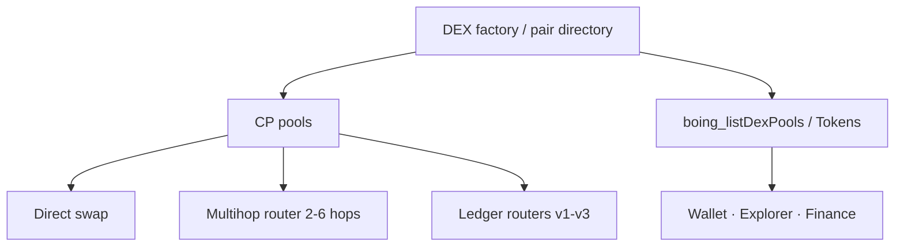

# Boing VM native DEX: what exists today

> 👋 **Everyday users:** swap on [boing.finance](https://boing.finance) when a canonical pool is published on the RPC you use. Hosted Fly testnet currently publishes `end_user.canonical_native_*` (verified 2026-11-01); always prefer the live RPC snapshot.  
> 🛠️ **Developers:** Boing VM programs + `boing-sdk` — not Solidity. Discovery: `boing_listDexPools` / `boing_listDexTokens`.  
> 🛰️ **Operators:** `npm run deploy-native-dex-full-stack` is an RPC script, **not** something `boing-node` runs on startup.

This document answers whether a **usable DEX-style product** can run **only** on Boing VM (no foreign execution engine on L1), and what is **not** replicated from typical EVM DEX stacks.

## What you can ship today (Boing VM only)

| Capability | Mechanism |
|------------|-----------|
| Constant-product pool | `constant_product_pool_bytecode` … **`v5`** — swap, add/remove liquidity, configurable fee (v3/v4), reference-token hooks (v2/v4), **`swap_to`** / **`remove_liquidity_to`** (v5) |
| Pair discovery / registry | `native_dex_factory_bytecode` — `register_pair`, `pairs_count`, `get_pair_at` ([NATIVE-DEX-FACTORY.md](./NATIVE-DEX-FACTORY.md)) |
| Single-hop forward through a contract | Ledger routers **v1–v3** ([NATIVE-DEX-LEDGER-ROUTER.md](./NATIVE-DEX-LEDGER-ROUTER.md)) |
| Two-hop swap in **one** tx | `native_dex_swap2_router_bytecode` ([NATIVE-DEX-SWAP2-ROUTER.md](./NATIVE-DEX-SWAP2-ROUTER.md)) |
| Multihop swap (**2–6** pools) in **one** tx | `native_dex_multihop_swap_router_bytecode` ([NATIVE-DEX-MULTIHOP-SWAP-ROUTER.md](./NATIVE-DEX-MULTIHOP-SWAP-ROUTER.md)); SDK `nativeDexSwap2Router.ts` |
| Fungible assets | [BOING-REFERENCE-TOKEN.md](./BOING-REFERENCE-TOKEN.md) templates + pool **`CALL`** |
| Optional **vault + fungible LP share** (product path) | [NATIVE-AMM-LP-VAULT.md](./NATIVE-AMM-LP-VAULT.md), [NATIVE-LP-SHARE-TOKEN.md](./NATIVE-LP-SHARE-TOKEN.md); canonical CREATE2 batch: **`npm run deploy-native-dex-lp-aux-contracts`** ([tutorial README](../examples/native-boing-tutorial/README.md) §7c2c) — not required for bare pool swaps |
| Deterministic deploy addresses | CREATE2 ([TECHNICAL-SPECIFICATION.md](./TECHNICAL-SPECIFICATION.md)), salts in `native_amm` / factory / routers |
| Access lists + SDK | `boing-sdk` encoders, simulation merge, factory scan helpers, swap2 / multihop calldata builders |
| Operator **one-shot deploy + wire + seed** | **`npm run deploy-native-dex-full-stack`** ([tutorial README](../examples/native-boing-tutorial/README.md) §7c1, [NATIVE-DEX-FULL-STACK-OUTPUT.md](./NATIVE-DEX-FULL-STACK-OUTPUT.md)) — RPC script, not `boing-node` startup |
| Off-chain quotes + path search | `boing-sdk` **`nativeDexRouting.ts`**: CP quotes, **`rankDirectCpPools`**, multi-hop **`findBestCpRoutes`** (≤ **6** hops by default), **`pickFirstMultihopCpRoute`**, **`uniqueSortedTokenHex32FromCpRoute`**, slippage floors, **`encodeNativeDexMultihopRouterCalldata*FromRoute`**, even-split aggregation, **`hydrateCpPoolVenuesFromRpc`**, **`fetchCpRoutingFromDirectoryLogs`** — execution via **`nativeDexSeamless`** (**`buildNativeDexMultihopSwapExpressTxFromRoute128`** / **`160`**, **`applyNativeDexMultihopSimulationToContractCallTx`**, optional **`includeVenueTokenAccounts`**) or your own **`contract_call`** |

Together, these are enough for **swaps**, **liquidity**, **registry**, **routing**, and **multi-hop (2–6 pools)** flows **if** the app builds calldata and deploys pools with separate **`ContractDeploy`** transactions.

## Known limitations (not EVM parity)

| Limitation | Detail |
|------------|--------|
| **Pair directory = register, not deploy** | The canonical directory only **`register_pair`**s. Permissionless CREATE2 pool create lives in the separate **create-and-seed** factory ([NATIVE-DEX-CREATE-AND-SEED.md](./NATIVE-DEX-CREATE-AND-SEED.md)); seed liquidity stays a sender-`CALLER` Batch step. See [NATIVE-DEX-FACTORY.md](./NATIVE-DEX-FACTORY.md) and [NATIVE-DEX-LIMITS-RATIONALE.md](./NATIVE-DEX-LIMITS-RATIONALE.md). |
| No Uniswap V3–style **concentrated liquidity** in canonical bytecode | Only the shipped **constant-product** programs; new curves need new VM contracts. |
| **LP** is pool-internal accounting by default | Not an ERC-20 LP token unless you add a separate token contract and wire it in product design. |
| **On-chain O(1) (tokenA, tokenB) → pool** | Pair directory uses indexed / scan patterns; no keccak mapping in baseline factory. |
| **More than six pools** in one multihop tx | Canonical multihop router caps at **6** sequential pool **`Call`s**; chain txs or a new router revision for longer paths ([NATIVE-DEX-MULTIHOP-SWAP-ROUTER.md](./NATIVE-DEX-MULTIHOP-SWAP-ROUTER.md)). |
| **TWAP / oracles** | Application and indexer concern unless you add oracle contracts ([BOING-PATTERN-ORACLE-PRICE-FEEDS.md](./BOING-PATTERN-ORACLE-PRICE-FEEDS.md)). |

## Bottom line

**Yes:** a **functional** DEX (swap, LP, list pairs, route, **2-hop** and **multihop** bundles) can exist **entirely** on Boing VM with the artifacts above plus reference tokens and off-chain/indexer support.

**No:** it is **not** a byte-for-byte Uniswap clone; concentrated liquidity remains out of scope. **Permissionless CREATE2 pool create** is available via the create-and-seed factory (pool bytecode in calldata + Batch seed); the pair directory itself stays register-only.

For **why** these differ from EVM and what extensions cost, see [NATIVE-DEX-LIMITS-RATIONALE.md](./NATIVE-DEX-LIMITS-RATIONALE.md). Engineering checklist and product-surface matrix are below.

## Engineering: DEX-style products on Boing L1

For protocol/VM engineers shipping factory / router / locker-style DeFi on Boing L1. Complements **boing.finance** [`native-dex.md`](https://github.com/Boing-Network/boing.finance/blob/main/docs/native-dex.md) and [`native-dex-discovery.md`](https://github.com/Boing-Network/boing.finance/blob/main/docs/native-dex-discovery.md).

### Facts about L1 today

- Application contracts are **Boing VM bytecode** via **`ContractDeploy`** (optional Create2 / `0xFD` init). Calls use **`ContractCall`** with Boing calldata words — not Solidity ABI ([NATIVE-AMM-CALLDATA.md](./NATIVE-AMM-CALLDATA.md)).
- Native CP AMM is ledger-native with a fixed calldata interface — not a drop-in Solidity DEXFactoryV2 graph.
- QA gates deploys; new DEX bytecode must be classified like other templates.
- **No EVM layer on L1** for user contracts — Solidity artifacts do not execute without a full reimplementation (which does not exist).

### What “porting the Solidity DEX” means

Deliverables are **new Boing VM programs** (and off-chain indexers) that implement the **same product requirements** — not the same bytecode. Suggested breakdown: Boing-native interface spec → VM implementation → QA/purpose → deploy AccountIds → SDK encoders + dApp env (`REACT_APP_BOING_NATIVE_VM_*`).

**Relationship:** The canonical CP pool is one specific program. A multi-pair factory is different ([NATIVE-DEX-FACTORY.md](./NATIVE-DEX-FACTORY.md)). Ledger routers v1–v3 ([NATIVE-DEX-LEDGER-ROUTER.md](./NATIVE-DEX-LEDGER-ROUTER.md)); multihop 2–6 hops ([NATIVE-DEX-MULTIHOP-SWAP-ROUTER.md](./NATIVE-DEX-MULTIHOP-SWAP-ROUTER.md)).

### Checklist before finance can “turn on” L1 DEX UI

- [x] Calldata + receipt/log specs (pool Log2, factory Log3, router payloads).
- [x] Pair directory bytecode + `register_pair` path.
- [ ] Directory + pools AccountIds on the **target** network (ops publish; optional routers/locker).
- [x] boing-sdk encoders, CREATE2 prediction, factory helpers, multihop builders.
- [x] Node RPC regression: `cargo test -p boing-node --test native_dex_factory_rpc_happy_path`.
- [x] Optional pair listing without ad-hoc scans — **partial** (Log3 + SDK; hosted catalog remains product-owned).

Until `nativeVm.*` env ids are set for a deployment, finance correctly keeps them at zero and uses native CP + EVM stacks where configured.

## Product surfaces (EVM | Solana | Boing-native)

Cross-links: [HANDOFF-DEPENDENT-PROJECTS.md](HANDOFF-DEPENDENT-PROJECTS.md). *Matrix refreshed 2026-11-01 (merged from former capability-matrix doc; prefer live RPC `end_user` for published ids).*

| Capability | EVM (finance) | Solana (finance) | Boing-native (L1 6913) |
|------------|---------------|------------------|-------------------------|
| Deploy fungible | TokenFactory / honest gate | SPL + Metaplex | **app-wired** — reference/secured bytecode + Express |
| Deploy NFT | EVM flows | Metaplex | **app-wired** — reference NFT via Express |
| Swap | Boing DEX or LI.FI | Jupiter | **app-wired** — CP pool when id published |
| Create pool / LP | DEXFactory / Uniswap-class | External | **app-wired** / **done** — deploy+seed; Liquidity page |
| Multi-pair / smart route | Boing router when live | Jupiter | **app-wired** — factory + multihop; needs published ids |
| Liquidity locker | when live | — | **needs operator deploy** |
| Pools / directory | GeckoTerminal | GeckoTerminal | **app-wired** — Observer + finance Pools; Worker empty-path honesty |
| Portfolio / bridge | EVM / LI.FI bridge | SOL+SPL | Portfolio **app-wired**; L1 bridge **planned** |
| Explorer / wallet | chain explorers | Solscan-class | Observer + **Express** (`contract_call` + access_list) |

**Still needs operators (not app code):** publish non-zero `BOING_CANONICAL_NATIVE_*`; bootstrap `register_pair` / seed; optional directory sync; L1 bridge protocol remains planned.

