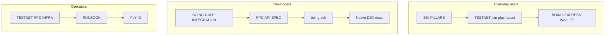

# 📚 Boing Network — Documentation Index

> **Quality, enforced by the protocol.** Brand foundation, naming and approved phrases: [../BRAND.md](../BRAND.md).

This folder is the **canonical map** of protocol docs. Website pages and PDFs are generated from a subset of these files — keep them aligned with what is actually shipped.

> 👋 **Everyday users:** start with [SIX-PILLARS.md](SIX-PILLARS.md), then the [Boing Express wallet](https://boing.express), [faucet](https://boing.network/faucet), and [Boing Observer explorer](https://boing.observer).
> 🛠️ **Developers:** start with [BOING-DAPP-INTEGRATION.md](BOING-DAPP-INTEGRATION.md), [RPC-API-SPEC.md](RPC-API-SPEC.md), and [boing-sdk](../boing-sdk/README.md).
> 🛰️ **Operators:** start with [TESTNET.md](TESTNET.md), [TESTNET-RPC-INFRA.md](TESTNET-RPC-INFRA.md), and [RUNBOOK.md](RUNBOOK.md).

Contributors: [CONTRIBUTING.md](../CONTRIBUTING.md).

PDFs on the site (`website/public/pdfs/`) are built with `npm run build:pdfs` in `website/`. Mermaid diagrams in the Markdown are rendered into those PDFs.

---

## 👋 Everyday users

| Doc | What you get |
|-----|----------------|
| [SIX-PILLARS.md](SIX-PILLARS.md) | Why Boing exists, in order of priority (also `/pdfs/SIX-PILLARS.pdf`) |
| [BOING-NETWORK-ESSENTIALS.md](BOING-NETWORK-ESSENTIALS.md) | Plain-language overview: products, what you can do, honest testnet limits |
| [FEATURES.md](FEATURES.md) | Product/protocol features with **when implemented** + status (also `/pdfs/FEATURES.pdf`) |
| [TESTNET.md](TESTNET.md) | Join testnet, faucet, portal, quests |
| [BOING-EXPRESS-WALLET.md](BOING-EXPRESS-WALLET.md) | How the wallet works (product lives at [boing.express](https://boing.express)) |
| [BOING-OBSERVER-AND-EXPRESS.md](BOING-OBSERVER-AND-EXPRESS.md) | Explorer + wallet: what each app is for |
| [QUALITY-ASSURANCE-NETWORK.md](QUALITY-ASSURANCE-NETWORK.md) | Allow / Reject / Unsure in plain language + deployer checklist |
| [QA-GATE-RULES.md](QA-GATE-RULES.md) | Operational catalog of every automated gate (also observer `/qa/rules` PDF) |
| [Executive-Summary-Pitch-Deck.md](Executive-Summary-Pitch-Deck.md) | Short pitch (PDF on the site) |

---

## 🛠️ Developers

| Doc | What you get |
|-----|----------------|
| [BOING-DAPP-INTEGRATION.md](BOING-DAPP-INTEGRATION.md) | Connect `window.boing`, simulate, submit, native DEX |
| [RPC-API-SPEC.md](RPC-API-SPEC.md) | **Source of truth** for the JSON-RPC surface (all 68 methods, errors, rejection reasons, DEX discovery, media blobs, HTTP probes); enforced by a unit test |
| [TECHNICAL-SPECIFICATION.md](TECHNICAL-SPECIFICATION.md) | Crypto, bincode, VM, gas, QA rules |
| [OPTIONAL-PRIORITY-FEES.md](OPTIONAL-PRIORITY-FEES.md) | Micro base fee (~0.00021 BOING/transfer) + optional priority tips |
| [NATIVE-DENOMINATION.md](NATIVE-DENOMINATION.md) | 18-decimal ledger units, fee schedule, faucet amounts |
| [NATIVE-BATCH-TRANSACTIONS.md](NATIVE-BATCH-TRANSACTIONS.md) | Native batch payload |
| [NATIVE-VALUE-AND-WBOING.md](NATIVE-VALUE-AND-WBOING.md) | Contract-call value + wrapped BOING |
| [BOING-MINI-IR.md](BOING-MINI-IR.md) | Mini-IR for Boing VM tooling |
| [INTERFACE-REGISTRY.md](INTERFACE-REGISTRY.md) | Interface / selector registry |
| [BOING-RPC-ERROR-CODES-FOR-DAPPS.md](BOING-RPC-ERROR-CODES-FOR-DAPPS.md) | Error codes wallets and UIs should map |
| [BOING-SIGNED-TRANSACTION-ENCODING.md](BOING-SIGNED-TRANSACTION-ENCODING.md) | **Source of truth** for the tx / block bincode layout, signing domains (v2, priority tip), payload indices |
| [ENVIRONMENT-VARIABLES.md](ENVIRONMENT-VARIABLES.md) | Every `BOING_*` environment variable, defaults, ports |
| [STORAGE-TREE-V2-ACTIVATION.md](STORAGE-TREE-V2-ACTIVATION.md) | Gated fix for the 64-bit storage-key prefix collision (testnet H=1500 crossed): design, activation, migration |
| [ACCOUNT-TREE-V3-ACTIVATION.md](ACCOUNT-TREE-V3-ACTIVATION.md) | Gated fix for the 64-bit account-id prefix collision (audit #61 item 30; testnet H=1500 crossed) |
| [PERFORMANCE.md](PERFORMANCE.md) | Benchmarks (state root, mempool admission) with before/after numbers |
| [BOING-CANONICAL-DEPLOY-ARTIFACTS.md](BOING-CANONICAL-DEPLOY-ARTIFACTS.md) | Pinned fungible / NFT bytecode |
| [BOING-REFERENCE-TOKEN.md](BOING-REFERENCE-TOKEN.md) | Reference fungible |
| [BOING-REFERENCE-NFT.md](BOING-REFERENCE-NFT.md) | Reference NFT (v3 `mint_batch` `0x06`, n≤500) |
| [BOING-L1-MEDIA-BLOBS.md](BOING-L1-MEDIA-BLOBS.md) | L1 media blobs (Phases 1–34, PHASE7 256 MiB on testnet, PutBlob / ACL download, Express publish sessions) |
| [BOING-LINKED-NFT-TOKEN.md](BOING-LINKED-NFT-TOKEN.md) | Enforced on-chain NFT↔token registry (live testnet AccountId, selectors `0xE0`–`0xE8`) |
| [BOING-BUILDER-ATTESTATION.md](BOING-BUILDER-ATTESTATION.md) | On-chain builder attestation registry (live testnet AccountId, selectors `0xE0`–`0xE6`; builder signal, not companions) |
| [E2-PARTNER-APP-NATIVE-BOING.md](E2-PARTNER-APP-NATIVE-BOING.md) | Partner native Boing apps |

### Native DEX and AMM

| Doc | What you get |
|-----|----------------|
| [BOING-NATIVE-DEX-CAPABILITY.md](BOING-NATIVE-DEX-CAPABILITY.md) | What ships today, engineering checklist, product surfaces |
| [NATIVE-AMM-INTEGRATION-CHECKLIST.md](NATIVE-AMM-INTEGRATION-CHECKLIST.md) | End-to-end integration + manual E2E smoke |
| [NATIVE-AMM-CALLDATA.md](NATIVE-AMM-CALLDATA.md) | Pool selectors, storage, Log2, CREATE2 salts |
| [NATIVE-AMM-CLI.md](NATIVE-AMM-CLI.md) | CLI helpers for native AMM |
| [NATIVE-DEX-CUSTODY-ROUTER.md](NATIVE-DEX-CUSTODY-ROUTER.md) | Custody router for v8/v9 pools |
| [AUDIT-61-PROTOCOL-SEMANTICS.md](AUDIT-61-PROTOCOL-SEMANTICS.md) | Audit #61 item 29 — why LP `min` / XOR allowance / custody `min_out=1` stay as-is |
| [GOVERNANCE-CONSENSUS-TX-ACTIVATION.md](GOVERNANCE-CONSENSUS-TX-ACTIVATION.md) | Audit #61 item 41 — quorum votes + consensus-tx activation plan |
| [WINDOWS-AUTHENTICODE.md](WINDOWS-AUTHENTICODE.md) | Hub Windows Authenticode secrets + readiness CI (no .pfx in repo) |
| [NATIVE-LP-VAULT-V2.md](NATIVE-LP-VAULT-V2.md) | LP vault v2 (token-pair pools) |
| [NATIVE-DEX-FACTORY.md](NATIVE-DEX-FACTORY.md) | Pair directory VM |
| [NATIVE-DEX-LEDGER-ROUTER.md](NATIVE-DEX-LEDGER-ROUTER.md) | Ledger forwarders v1–v3 |
| [NATIVE-DEX-SWAP2-ROUTER.md](NATIVE-DEX-SWAP2-ROUTER.md) | Two-hop router |
| [NATIVE-DEX-MULTIHOP-SWAP-ROUTER.md](NATIVE-DEX-MULTIHOP-SWAP-ROUTER.md) | Multihop router (2–6 hops) |
| [NATIVE-AMM-LP-VAULT.md](NATIVE-AMM-LP-VAULT.md) | LP vault |
| [NATIVE-LP-SHARE-TOKEN.md](NATIVE-LP-SHARE-TOKEN.md) | LP share token |
| [HANDOFF_Boing_Network_Global_Token_Discovery.md](HANDOFF_Boing_Network_Global_Token_Discovery.md) | `boing_listDexPools` / `boing_listDexTokens` / `boing_getDexToken` |
| [HANDOFF_NATIVE_DEX_DIRECTORY_R2_AND_CHAIN.md](HANDOFF_NATIVE_DEX_DIRECTORY_R2_AND_CHAIN.md) | Native DEX directory Worker (source of truth) |

---

## 🛰️ Operators and testnet

| Doc | What you get |
|-----|----------------|
| [TESTNET-RPC-INFRA.md](TESTNET-RPC-INFRA.md) | **Operator hub:** go-live order, env matrix, verification |
| [TESTNET.md](TESTNET.md) | Join testnet; **§9.1** node zip release checklist |
| [TESTNET-VALIDATOR-GUIDE.md](TESTNET-VALIDATOR-GUIDE.md) | Open validator registration, bond, liveness |
| [PUBLIC-RPC-WAF-GUIDANCE.md](PUBLIC-RPC-WAF-GUIDANCE.md) | WAF / edge guidance for public RPC |
| [RUNBOOK.md](RUNBOOK.md) §9 | Operations watchlist (1500 soak, gateway edge, CF Free limits) |
| [HANDOFF_BLOB_DOWNLOAD_ACL.md](HANDOFF_BLOB_DOWNLOAD_ACL.md) | Blob download ACL (Phase 34) |
| [NODE-OPERATOR-COMMANDS.md](NODE-OPERATOR-COMMANDS.md) | Copy/paste RPC smoke and tutorial `npm run` commands |
| [INFRASTRUCTURE-SETUP.md](INFRASTRUCTURE-SETUP.md) | Home-lab bootnodes appendix; public RPC is Fly + Worker |
| [FLY-IO.md](FLY-IO.md) | Hosted Fly `boing-testnet-1` + public RPC Worker + **upgrade checklist** |
| [DEVNET-OPERATOR-NATIVE-AMM.md](DEVNET-OPERATOR-NATIVE-AMM.md) | Self-hosted RPC + deploy native DEX stack |
| [NETWORKS-API.md](NETWORKS-API.md) | Public node listing API: `/api/networks`, `meta` fields, D1 refresh |
| [TESTNET.md](TESTNET.md) §7 | Validator + full node on two Windows PCs |
| [OPS-CANONICAL-TESTNET-NATIVE-AMM-POOL.md](OPS-CANONICAL-TESTNET-NATIVE-AMM-POOL.md) | Canonical pool + aux CREATE2 + fresh bootstrap (**OPS hub**) |
| [NATIVE-DEX-OPERATOR-DEPLOYMENT-RECORD.md](NATIVE-DEX-OPERATOR-DEPLOYMENT-RECORD.md) | Operator deployment snapshots |
| [NATIVE-DEX-FULL-STACK-OUTPUT.md](NATIVE-DEX-FULL-STACK-OUTPUT.md) | `deploy-native-dex-full-stack` JSON reference |
| [WEBSITE-AND-DEPLOYMENT.md](WEBSITE-AND-DEPLOYMENT.md) | boing.network site deploy |
| [PLAYWRIGHT-E2E-CI-OPS.md](PLAYWRIGHT-E2E-CI-OPS.md) | Extension E2E CI limits |

---

## ✅ Quality, security, alignment

| Doc | What you get |
|-----|----------------|
| [QUALITY-ASSURANCE-NETWORK.md](QUALITY-ASSURANCE-NETWORK.md) | Protocol QA, community pool, content blocklist, canonical JSON index (`docs/config/`) |
| [QA-GATE-RULES.md](QA-GATE-RULES.md) | Enforced rule IDs, opcode whitelist, content matching, live vs canonical lists |
| [SECURITY-STANDARDS.md](SECURITY-STANDARDS.md) | Protocol, network, application security |
| [THREE-CODEBASE-ALIGNMENT.md](THREE-CODEBASE-ALIGNMENT.md) | Sync boing.network / express / observer / finance |
| [HANDOFF-DEPENDENT-PROJECTS.md](HANDOFF-DEPENDENT-PROJECTS.md) | Cross-repo work backlog |
| [HANDOFF_Universal_Contract_Deploy_Indexer.md](HANDOFF_Universal_Contract_Deploy_Indexer.md) | Universal deploy registry Worker |
| [HANDOFF_NFT_OWNER_INDEX.md](HANDOFF_NFT_OWNER_INDEX.md) | Durable reference-NFT owner index Worker (`/v1/nfts/by-owner`) |
| [INDEXER-RECEIPT-AND-LOG-INGESTION.md](INDEXER-RECEIPT-AND-LOG-INGESTION.md) | Receipt + log ingestion spec |
| [OBSERVER-HOSTED-SERVICE.md](OBSERVER-HOSTED-SERVICE.md) | Hosted observer architecture (OBS-1) |
| [INDEXER-OPERATOR-STATS.md](INDEXER-OPERATOR-STATS.md) | Operator stats / leaderboard |

---

## 🗺️ Roadmaps and design

| Doc | What you get |
|-----|----------------|
| [FEATURES.md](FEATURES.md) | Shipped / gated / deferred timeline (heights + tags) |
| [TESTNET.md](TESTNET.md) Part 3.1 | Beta readiness checklist (former READINESS.md) |
| [BUILD-ROADMAP.md](BUILD-ROADMAP.md) | Implementation phases (historical + remaining) |
| [NEXT-STEPS-FUTURE-WORK.md](NEXT-STEPS-FUTURE-WORK.md) | Backlog router — infra, native AMM, indexer, ops |
| [BOING-VM-CAPABILITY-PARITY-ROADMAP.md](BOING-VM-CAPABILITY-PARITY-ROADMAP.md) | Full-stack capability matrix |
| [EXECUTION-PARITY-TASK-LIST.md](EXECUTION-PARITY-TASK-LIST.md) | VM / receipts / RPC code tasks |
| [DEVELOPMENT-AND-ENHANCEMENTS.md](DEVELOPMENT-AND-ENHANCEMENTS.md) | Strategic vision (non-normative TBD sections) |
| [PROTOCOL_NATIVE_DEX_RPC_AND_INDEXING_ROADMAP.md](PROTOCOL_NATIVE_DEX_RPC_AND_INDEXING_ROADMAP.md) | Protocol drafts: simulate, LP positions, indexer |
| [BOING-BLOCKCHAIN-DESIGN-PLAN.md](BOING-BLOCKCHAIN-DESIGN-PLAN.md) | Architecture, tokenomics, design decisions |
| [BOING-INFRASTRUCTURE-INDEPENDENCE.md](BOING-INFRASTRUCTURE-INDEPENDENCE.md) | Hosting independence + Boing VM independence (§9) |
| [BOING-DESIGN-SYSTEM.md](BOING-DESIGN-SYSTEM.md) | Site design tokens |
| [DECENTRALIZATION-AND-NETWORKING.md](DECENTRALIZATION-AND-NETWORKING.md) | P2P, discovery roadmap |
| [NETWORK-COST-ESTIMATE.md](NETWORK-COST-ESTIMATE.md) | Cost overview |
| [ACCELERATOR-APPLICATIONS.md](ACCELERATOR-APPLICATIONS.md) | Draft accelerator answers |

### Patterns

| Doc | What you get |
|-----|----------------|
| [BOING-PATTERN-AMM-LIQUIDITY.md](BOING-PATTERN-AMM-LIQUIDITY.md) | AMM pattern |
| [BOING-PATTERN-ORACLE-PRICE-FEEDS.md](BOING-PATTERN-ORACLE-PRICE-FEEDS.md) | Oracle pattern (future) |
| [BOING-PATTERN-UPGRADE-PROXY.md](BOING-PATTERN-UPGRADE-PROXY.md) | Upgrade proxy pattern (future) |
| [NATIVE-DEX-LIMITS-RATIONALE.md](NATIVE-DEX-LIMITS-RATIONALE.md) | Why native DEX differs from EVM |
