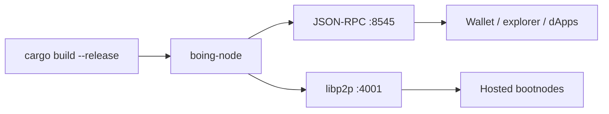

# Boing Network — Operational Runbook

> 👋 **Everyday users:** you probably want the [faucet](https://boing.network/faucet) and the [validator guide](TESTNET.md), not this file.  
> 🛠️ **Developers:** local node is `cargo run -p boing-node` on port **8545**.  
> 🛰️ **Operators:** this is the runbook — setup, RPC, CLI, monitoring, incidents, testnet ops.

**Purpose:** Operations guide for running and maintaining Boing Network nodes.  
**References:** [BOING-NETWORK-ESSENTIALS.md](BOING-NETWORK-ESSENTIALS.md), [BUILD-ROADMAP.md](BUILD-ROADMAP.md), [README.md](../README.md), [RPC-API-SPEC.md](RPC-API-SPEC.md), [READINESS.md](READINESS.md), [TESTNET-RPC-INFRA.md](TESTNET-RPC-INFRA.md)



---

## Network essentials (six pillars)

The network prioritizes, in order: **1. Security** → **2. Scalability** → **3. Decentralization** → **4. Authenticity** → **5. Transparency** → **6. True quality assurance**. For the full description of each pillar and design philosophy, see [BOING-NETWORK-ESSENTIALS.md](BOING-NETWORK-ESSENTIALS.md).

---

## Table of Contents

1. [Node Setup](#1-node-setup)
2. [Running a Node](#2-running-a-node)
3. [RPC Endpoints](#3-rpc-endpoints)
4. [CLI Usage](#4-cli-usage)
5. [Monitoring & Health](#5-monitoring--health)
6. [Incident Response](#6-incident-response)
7. [Troubleshooting](#7-troubleshooting)
8. [Testnet Operations](#8-testnet-operations)

---

## 1. Node Setup

### Prerequisites

- **Rust:** 1.70+ (`rustup` recommended)
- **OS:** Linux, macOS, or Windows (WSL recommended on Windows)

### Build

```bash
cargo build --release
```

### Directory Layout

| Path | Description |
|------|-------------|
| `target/release/boing-node` | Node binary |
| `target/release/boing` | CLI binary |
| `~/.boing/` or `./data/` | Data directory (when using `--data-dir`) |

---

## 2. Running a Node

### Full Node (non-validator)

```bash
cargo run -p boing-node
```

Defaults: RPC on `http://127.0.0.1:8545`.

### Validator Node

```bash
cargo run -p boing-node -- --validator --rpc-port 8545
```

Produces blocks when there are pending transactions.

### With Data Directory

```bash
cargo run -p boing-node -- --data-dir ./boing-data --rpc-port 8545
```

Persists chain, QA policy (`qa_registry.json` / `qa_pool_config.json`), and native fee policy (`network_fee_config.json`). Override at start with `--qa-registry`, `--qa-pool-config`, and `--network-fee-config`. Canonical shapes: [`docs/config/qa_pool_config.canonical.json`](config/qa_pool_config.canonical.json), [`docs/config/network_fee_config.canonical.json`](config/network_fee_config.canonical.json) (**micro** `execution_gas_fee_bps=100` + tip BPS). Protocol gas split defaults **100% to `PROTOCOL_TREASURY`**; tips default **100% to the proposer** (`tip_proposer_bps`); mining emission still credits the round proposer. See [OPTIONAL-PRIORITY-FEES.md](OPTIONAL-PRIORITY-FEES.md).

### Mempool: pending transactions per sender

Each account may have only **N** distinct pending nonces in the mempool at once (default **N = 16**, aligned with [`RateLimitConfig::default_mainnet`](../crates/boing-node/src/security.rs)). The process logs `Mempool: max pending txs per sender = …` at startup. Operators can raise the cap (e.g. busy testnet RPC) with:

```bash
cargo run -p boing-node -- --validator --rpc-port 8545 --pending-txs-per-sender 64
```

Nonce **replacements** for the same nonce do not count toward the cap.

### Dev rate-limit profile (local / busy testnet)

For **relaxed** JSON-RPC rate limits and a **64** pending-tx cap per sender (see [`RateLimitConfig::default_devnet`](../crates/boing-node/src/security.rs)):

```bash
cargo run -p boing-node -- --validator --rpc-port 8545 --dev-rate-limits
```

Same effect without the flag (e.g. Docker / systemd):

```bash
export BOING_RATE_PROFILE=dev
cargo run -p boing-node -- --validator --rpc-port 8545
```

Use **`BOING_RATE_PROFILE=mainnet`** to force the strict profile even if **`--dev-rate-limits`** is mistakenly present on a public RPC host.

You can still override only the mempool cap: `--dev-rate-limits --pending-txs-per-sender 128`. **Do not** use the dev profile on public mainnet RPC endpoints.

### Environment variables and hardening checklist

Every `BOING_*` variable, its default and the default ports are listed in [ENVIRONMENT-VARIABLES.md](ENVIRONMENT-VARIABLES.md). For any node whose RPC port is reachable beyond localhost:

- Set **`BOING_OPERATOR_RPC_TOKEN`**. Without it, operator-only methods (`boing_operatorApplyFeePolicy`, `boing_operatorApplyQaPolicy`, `boing_submitSlashAppeal`, `boing_resolveSlashAppeal`, `boing_registerBlsDualKey`, `boing_putBlobSampleOffer`, and `boing_qaPoolVote` unless the QA pool has public membership) are rejected with `-32057` (fail-closed). Existing deployments that relied on the old open behavior must now set the token and send `X-Boing-Operator`.
- Keep the rate profile at `mainnet` (default); never use `--dev-rate-limits` on public RPC.
- Never pass `--faucet-enable` on mainnet; the faucet key is public. **Enforced:** when `BOING_CHAIN_ID=6914` (mainnet) the node exits at startup if `BOING_OPERATOR_RPC_TOKEN` is unset/blank, or if `--faucet-enable` is passed (also checked against the installed network history's chain id). Testnet (6913), devnets and unset chain ids do not refuse to start without the token and may enable the faucet, but operator-only methods are still rejected (fail-closed, `-32057`) until the token is set, so set it on any node where you need them.
- Keep `BOING_VALIDATOR_KEY` in a secret store (Fly secrets), not in `fly.toml` or shell history.
- Public RPC: the node's HTTP rate limit is one global bucket, so per-IP limits, a method allow-list and origin lock-down belong at the edge. The rules are config-as-code in `ops/cloudflare/public-rpc/`: `node scripts/public-rpc-edge.mjs check` (drift check), `node scripts/public-rpc-edge.mjs apply` (dry run), `CLOUDFLARE_API_TOKEN=... CLOUDFLARE_ZONE_ID=... node scripts/public-rpc-edge.mjs apply --apply` (applies; `--remove --apply` rolls back). The zone rate-limit rules depend on the Cloudflare plan (`zone_rules.plan` in `policy.json`, default **free**: one rule, 100 requests / 10 s per IP on path `/`, block; or `--plan pro|business|enterprise`); per-method-class limits live in the gateway Worker. After upgrading the plan, change `zone_rules.plan` and re-run generate + apply. Numbers, rationale and rollout order: [PUBLIC-RPC-WAF-GUIDANCE.md](PUBLIC-RPC-WAF-GUIDANCE.md#2a-implemented-edge-policy-config-as-code).

### Storage-tree v2 activation (testnet only for now)

Off by default; mainnet unset. The testnet rollout (proposed height, script, per-node verification via `boing_getNetworkInfo.storage_tree_v2_activation_height`, rollback and the mainnet gate) is in [STORAGE-TREE-V2-ACTIVATION.md](STORAGE-TREE-V2-ACTIVATION.md#testnet-rollout-chain-6913-only). Compute the height with `node scripts/compute-activation-height.mjs`; the variable must be on **every** node before the head reaches it.

Day-of checklist (what to check in logs and state roots, the last moment to roll back, what a fork looks like): [OPERATIONS-WATCHLIST.md](OPERATIONS-WATCHLIST.md#1-testnet-1500-crossing-watch-storage-tree-v2--account-tree-v3--vm-hardening-chain-6913).

### Gossip limits and rollout (P2P)

- Max gossip frame is configurable and defaults to **17 MiB** (libp2p's own default is 64 KiB). Peers still on the old 64 KiB default drop larger frames, so a block bigger than 64 KiB only reaches upgraded peers. **Upgrade every validator and bootnode to this build before relying on large blocks**; mixed networks keep working for small blocks.
- Each forwarding peer is limited by token buckets (default **500 msgs/s** and **64 MiB/s**, burst 2 s; `0` = unlimited). Excess messages are ignored (not relayed, logged as `gossip_peer_rate_limited`). Received messages are validated and reported to gossipsub as Accept / Reject / Ignore so peers that relay invalid data lose score.
- Variables: `BOING_P2P_MAX_GOSSIP_MESSAGE_BYTES`, `BOING_P2P_GOSSIP_MAX_*_PER_PEER`, `BOING_P2P_PEER_SCORING` in [ENVIRONMENT-VARIABLES.md](ENVIRONMENT-VARIABLES.md).

### Receipt retention

The node keeps transaction receipts for a window of recent blocks (default **1,000,000**, pruned every 256 blocks; `0` = keep everything). `boing_getTransactionReceipt` returns `null` for transactions older than the window; older receipts stay on disk but are not served. Indexers that backfill from genesis should set `BOING_RECEIPT_RETENTION_BLOCKS=0` or backfill from blocks instead.

### JSON-RPC surface (stale binary or proxy)

If **`boing_chainHeight`** works but other **`boing_*`** calls return **`-32601` Method not found**, the process on the RPC port is almost certainly an **older `boing-node` build** or a **proxy that drops unknown methods**. Rebuild from the current repository (`cargo build -p boing-node --release`) and restart. To see which read-only methods the URL exposes, run **`npm run build`** then **`npm run probe-rpc`** in **`boing-sdk`**, or **`npm run probe-rpc`** from the repository root (prints a **`diagnosis`** when methods are missing). **No SDK build:** from the repo root run **`npm run rpc-endpoint-check`** for a raw JSON-RPC table. **Windows — who owns port 8545:** `netstat -ano | findstr :8545`, then `tasklist /FI "PID eq <pid>" /V` (ensure the image is the **`boing-node`** you just built, not an old `cargo install` path). The tutorial package also exposes **`npm run probe-rpc`**. See [RPC-API-SPEC.md](RPC-API-SPEC.md) § Diagnosing `-32601`.

**Public RPC — chain id for dApps:** Set environment **`BOING_CHAIN_ID=6913`** and **`BOING_CHAIN_NAME=Boing Testnet`** on the **`boing-node`** process so **`boing_getNetworkInfo`** returns them (matches wallet **`boing_chainId`** **`0x1b01`**). Copy-paste template: [`tools/boing-node-public-testnet.env.example`](../tools/boing-node-public-testnet.env.example). **systemd / Docker / Kubernetes:** [`tools/boing-node-public-testnet.systemd.example`](../tools/boing-node-public-testnet.systemd.example), [`tools/boing-node-public-testnet.docker-compose.yml`](../tools/boing-node-public-testnet.docker-compose.yml), [`tools/boing-node-public-testnet.kubernetes.example.yaml`](../tools/boing-node-public-testnet.kubernetes.example.yaml) — see [`tools/README.md`](../tools/README.md). Wallets can still use a fixed chain id from app config when the field is **`null`**.

**Canonical native DEX addresses (optional, recommended for public RPC):** Set **`BOING_CANONICAL_NATIVE_CP_POOL`**, **`BOING_CANONICAL_NATIVE_DEX_FACTORY`**, and (when deployed) **`BOING_CANONICAL_NATIVE_DEX_MULTIHOP_SWAP_ROUTER`**, **`BOING_CANONICAL_NATIVE_DEX_LEDGER_ROUTER_V2`**, **`BOING_CANONICAL_NATIVE_DEX_LEDGER_ROUTER_V3`**, **`BOING_CANONICAL_NATIVE_AMM_LP_VAULT`**, **`BOING_CANONICAL_NATIVE_LP_SHARE_TOKEN`** to **32-byte `AccountId` hex** (64 hex chars, optional **`0x`**). They appear under **`boing_getNetworkInfo`**.**`end_user`** so dApps can call **`fetchNativeDexIntegrationDefaults`** without hardcoding the full router / LP stack ([RPC-API-SPEC.md](RPC-API-SPEC.md), [BOING-DAPP-INTEGRATION.md](BOING-DAPP-INTEGRATION.md)).

---

## 3. RPC Endpoints

Common methods only; the complete list (66 methods, params, errors, rejection reasons) is [RPC-API-SPEC.md](RPC-API-SPEC.md).

| Method | Params | Description |
|--------|--------|-------------|
| `boing_submitTransaction` | `[hex_signed_tx]` | Submit a signed transaction |
| `boing_chainHeight` | `[]` | Current chain height |
| `boing_getSyncState` | `[]` | Committed tip: head / finalized / latest block hash |
| `boing_getNetworkInfo` | `[]` | dApp discovery: tip + timing + optional **`chain_id`** / **`chain_name`** (env); explicit non-availability of chain-wide TVL / APY — [RPC-API-SPEC.md](RPC-API-SPEC.md) |
| `boing_getBalance` | `[hex_account_id]` | Spendable balance (decimal string) |
| `boing_getAccount` | `[hex_account_id]` | Balance, nonce, stake (for wallets and tx building) |
| `boing_getBlockByHeight` | `[height]` | Block at height (u64) |
| `boing_getBlockByHash` | `[hex_block_hash]` | Block by hash (32 bytes hex) |
| `boing_getAccountProof` | `[hex_account_id]` | Merkle proof for account |
| `boing_verifyAccountProof` | `[hex_proof, hex_state_root]` | Verify Merkle proof |
| `boing_simulateTransaction` | `[hex_signed_tx]` | Simulate tx (gas, success) |
| `boing_registerDappMetrics` | `[hex_contract, hex_owner]` | Register dApp for incentives |
| `boing_submitIntent` | `[hex_signed_intent]` | Submit signed intent for solver fulfillment |
| `boing_faucetRequest` | `[hex_account_id]` | Testnet only: request testnet BOING (node must be started with `--faucet-enable`) |
| `boing_getLogs` | `[{ fromBlock, toBlock, address?, topics? }]` | Bounded log query (max **128** inclusive heights, **2048** rows per call); see [RPC-API-SPEC.md](RPC-API-SPEC.md) |

### Public RPC operators and `boing_getLogs`

- **`boing_getLogs` is more expensive than single-block reads** (each call scans up to **128** committed heights and may return up to **2048** log rows). On **shared** or **rate-limited** endpoints, operators should **document** whether the method is enabled and any **extra limits** (e.g. lower QPS than `boing_chainHeight`).
- If you need to protect the node, prefer **global RPC rate limits** (see `RateLimitConfig` / node defaults) or a **reverse proxy** rule; disabling the method is a last resort and breaks indexers that rely on it—see [INDEXER-RECEIPT-AND-LOG-INGESTION.md](INDEXER-RECEIPT-AND-LOG-INGESTION.md).
- **Indexer clients:** use **`boing-sdk`** **`getLogsChunked`** (or equivalent chunking) so each RPC stays within the **128**-block cap; default **`maxConcurrent: 1`** on wide backfills is polite on public tiers. For full block + receipt replay, **`fetchBlocksWithReceiptsForHeightRange`** and **`planIndexerCatchUp`** are documented in the same indexer guide and in [examples/native-boing-tutorial](../examples/native-boing-tutorial/) (`npm run indexer-ingest-tick`).
- **Internet-facing smoke (no keys):** from the tutorial package, **`npm run preflight-rpc`** with public **`BOING_RPC_URL`** exercises **`check-testnet-rpc`** plus a one-shot **`getSyncState`** sample; command matrix: [NODE-OPERATOR-COMMANDS.md](NODE-OPERATOR-COMMANDS.md).

Example (curl):

```bash
curl -X POST http://127.0.0.1:8545/ -H "Content-Type: application/json" \
  -d '{"jsonrpc":"2.0","id":1,"method":"boing_chainHeight","params":[]}'
```

---

## 4. CLI Usage

| Command | Description |
|---------|-------------|
| `boing init [name]` | Scaffold a new dApp project |
| `boing dev [--port 8545]` | Start local dev chain |
| `boing deploy [path]` | Check RPC reachability (deploy submission is via SDK or `boing token`) |
| `boing token deploy --symbol <SYM> [--initial-supply N]` | Deploy the native reference fungible token; also `mint`, `transfer`, `balance`, `bytecode` |
| `boing qa apply --registry <path> --pool <path>` | Operator: push QA registry / pool config |
| `boing metrics register --contract <hex> --owner <hex>` | Register contract for dApp incentives |
| `boing completions <shell>` | Generate shell completion (bash, zsh, fish, powershell, elvish) |

### Shell Completion

```bash
# Bash
boing completions bash > /etc/bash_completion.d/boing  # or ~/.local/share/bash-completion/completions/boing

# Zsh
boing completions zsh > ~/.zsh/completions/_boing

# Fish
boing completions fish > ~/.config/fish/completions/boing.fish
```

---

## 5. Monitoring & Health

### Chain Height

```bash
curl -s -X POST http://127.0.0.1:8545/ -H "Content-Type: application/json" \
  -d '{"jsonrpc":"2.0","id":1,"method":"boing_chainHeight","params":[]}' | jq
```

### Block Query

```bash
curl -s -X POST http://127.0.0.1:8545/ -H "Content-Type: application/json" \
  -d '{"jsonrpc":"2.0","id":1,"method":"boing_getBlockByHeight","params":[0]}' | jq
```

### Logs

Set `RUST_LOG` before running:

```bash
RUST_LOG=info cargo run -p boing-node
# Debug: RUST_LOG=debug
# Trace: RUST_LOG=trace
```

---

## 6. Incident Response

For security incidents and vulnerabilities:

| Step | Action |
|------|--------|
| 1. **Detect** | Monitor logs, alerts, community reports. |
| 2. **Assess** | Classify severity: Low, Medium, High, Critical. |
| 3. **Contain** | Isolate affected systems; pause if necessary. |
| 4. **Communicate** | Notify validators, users, ecosystem per severity. |
| 5. **Remediate** | Apply fixes; coordinate upgrades via governance if needed. |
| 6. **Post-mortem** | Document cause, impact, and prevention. |

**Contacts:** [SECURITY-STANDARDS.md](SECURITY-STANDARDS.md) § **5. Security Contacts** (responsible disclosure via GitHub Security Advisories; bug bounty **TBD**).

---

## 6b. Scalability Characteristics

- **Block time:** ~2 seconds target when transactions are pending (configurable via tokenomics). Blocks are produced only when transactions are present, so an idle network not advancing is normal.
- **Throughput:** Parallel transfer batches; access-list batching reduces conflicts
- **Gas / fees:** Fixed gas per tx type; **fee market v1** scales the historical schedule by `execution_gas_fee_bps` (recommended **100** → ~**0.00021 BOING**/transfer) plus optional `extra_fixed_fee` / `transfer_amount_bps` / blob fees. Optional **`priority_tip`** for inclusion priority (split via `tip_*_bps`, default 100% proposer). Protocol gas default split is **100% treasury**; block **emission** still goes to the round proposer. Height gate: `BOING_MICRO_FEES_ACTIVATION_HEIGHT`. Override via `network_fee_config.json` / `boing_operatorApplyFeePolicy` ([OPTIONAL-PRIORITY-FEES.md](OPTIONAL-PRIORITY-FEES.md), [TECHNICAL-SPECIFICATION.md](TECHNICAL-SPECIFICATION.md) §8.4).
- **Batching:** Scheduler groups non-conflicting txs; transfers with disjoint access lists run in parallel

## 6c. Decentralization Design

- **Permissionless validation:** No whitelist; anyone with stake can validate
- **P2P discovery:** Bootnodes for bootstrap; mDNS for LAN; DHT (roadmap) for discovery
- **No central gatekeeper:** Consensus, governance, and QA pool are decentralized
- **Single-client today:** Multiple implementations encouraged for resilience

## 7. Troubleshooting

### Node won't start

1. Ensure port 8545 (or `--rpc-port`) is free.
2. Check `RUST_LOG=debug` for errors.
3. On Windows: ensure no firewall blocking; try WSL if TCP binding fails.

### Transaction not included

- Validator mode must be enabled for block production.
- Check mempool size and nonce ordering.
- Simulate first: `boing_simulateTransaction` to validate.
- **Note:** If block production or consensus fails, transactions are re-inserted into the mempool automatically so they can be retried in the next round.

### RPC returns "Method not found"

- Ensure you're using the exact method name (case-sensitive).
- Params must be a JSON array (e.g. `"params": []` not `"params": {}`).

### Build fails

```bash
cargo clean
cargo build
```

---

## 8. Testnet Operations

If a **public incentivized testnet** is run in the future (none is running today), the following operations keep bootnodes and the faucet available. See [TESTNET.md](TESTNET.md) Part 3 for the full launch checklist.

### 8.1 Running a bootnode

A **bootnode** is a node with a stable, publicly reachable address that other nodes use to join the network.

1. **Build:** `cargo build --release`
2. **Run with P2P and a fixed port:**
   ```bash
   ./target/release/boing-node \
     --p2p-listen /ip4/0.0.0.0/tcp/4001 \
     --validator \
     --rpc-port 8545 \
     --data-dir ./bootnode-data
   ```
3. **Publish the multiaddr:** Your bootnode address is `/ip4/<YOUR_PUBLIC_IP>/tcp/4001`. Ensure TCP port 4001 (and 8545 if RPC is public) is open in the firewall. Add this multiaddr to [TESTNET.md](TESTNET.md) §6 and to `website/src/config/testnet.ts` (or set `PUBLIC_BOOTNODES` at build time).
4. **Recommendation:** Run at least **two** bootnodes on different hosts for redundancy.
5. **P2P transaction gossip:** After a successful **`boing_submitTransaction`** or **`boing_faucetRequest`**, the node gossips the **signed** transaction on `boing/transactions`. Peers verify the signature and apply the same mempool + QA rules as RPC submissions (duplicates and rejects are dropped at debug log level). **Regression:** `cargo test -p boing-node --test p2p_tx_gossip_rpc` (four-node full mesh: RPC submit on one peer → another peer’s mempool contains the same tx id). **Note:** libp2p gossipsub’s default mesh size means **two peers alone** may not propagate topic messages reliably; production testnets should run enough connected peers (or tune gossipsub — see `boing-p2p`).
6. **Connections per IP:** The active rate-limit profile caps simultaneous P2P connections from the same remote IPv4/IPv6 address (mainnet profile **50**, dev profile **100**). Override with **`--max-connections-per-ip N`**; use **`0`** for unlimited (not recommended on public listeners).
7. **Multi-validator consensus (optional):** By default the node is **single-validator** (local AccountId `[1u8; 32]`). For a multi-validator testnet, set a shared static set and this node’s signing key:

   ```bash
   cargo run -p boing-node -- \
     --p2p-listen /ip4/0.0.0.0/tcp/4001 \
     --validator \
     --validators <HEX32>,<HEX32>,<HEX32>,<HEX32> \
     --validator-key <HEX32_SECRET> \
     --rpc-port 8545 --data-dir ./data
   ```

   Env equivalents: **`BOING_VALIDATORS`**, **`BOING_VALIDATOR_KEY`**. Round-robin leader proposes; followers vote on `boing/votes`; tip advances at **2f+1** quorum. **Regression:** `cargo test -p boing-node --test multi_validator_consensus`.

8. **Stake-derived validator set (optional):** After a static bootstrap set is configured, enable epoch refresh from top stakers:

   ```bash
   cargo run -p boing-node -- \
     --validator \
     --validator-set stake \
     --stake-validator-top-n 21 \
     --stake-validator-epoch-len 100 \
     --validators <HEX32>,... \
     --validator-key <HEX32_SECRET> \
     --rpc-port 8545 --data-dir ./data
   ```

   Env: **`BOING_VALIDATOR_SET=stake`**, **`BOING_STAKE_VALIDATOR_TOP_N`** (default **21**), **`BOING_STAKE_VALIDATOR_EPOCH_LEN`** (default **100**), **`BOING_STAKE_VALIDATOR_MIN_STAKE`** (default **10000**). On each commit where `height % epoch_len == 0` (and `height ≥ epoch_len`), the node replaces the consensus set with accounts whose **active stake ≥ min_stake** from `StateStore::top_stakers`, and **always retains the local validator** so this process can still vote. If nobody meets the threshold, the current set is kept. **Unbonding:** `Unbond` queues stake for **`UNBONDING_DELAY_BLOCKS`** (100); claim with **`ClaimUnbond`**. **Leader election:** `--leader-election vrf` / **`BOING_LEADER_ELECTION=vrf`** (default `round_robin`) — ECVRF proofs on `boing/vrf-proofs` when the full set is present, else BLAKE3 stub. **Equivocation slash:** conflicting votes (local or gossiped `EquivocationEvidence`) are included via consensus tx **`ReportEquivocation` (36)**, which burns **`EQUIVOCATION_SLASH_BPS`** (50%) of the offender’s active stake during block execution (so peers share one state root), seeds the consensus slash-appeal book, and mirrors into **`SlashRegistry`** (`slash_registry.json` when `--data-dir` is set). Prefer on-chain **`SubmitSlashAppeal` / `ResolveSlashAppeal*`** for restores; operator RPC resolve does not mutate committed stake. **Liveness:** open-validator jail is on-chain; stake-mode **`tick_liveness`** is diagnostics-only (no out-of-block stake burn). **Regression:** `cargo test -p boing-node --test stake_validator_epochs`; `cargo test -p boing-node --test equivocation_slash`; `cargo test -p boing-node --test liveness_slash`. Remaining gaps (production ECVRF; consensus-ordered stake-mode liveness evidence) are tracked in [NEXT-STEPS-FUTURE-WORK.md](NEXT-STEPS-FUTURE-WORK.md).

### 8.2 Running the faucet node

The **faucet** is an RPC method (`boing_faucetRequest`) on a node started with `--faucet-enable`. Use a dedicated node (or a node behind your public RPC) so the website faucet page can target it.

1. **Build:** `cargo build --release`
2. **Run with faucet enabled:**
   ```bash
   ./target/release/boing-node \
     --validator \
     --faucet-enable \
     --rpc-port 8545 \
     --data-dir ./faucet-data
   ```
   For the **public testnet**, also use `--p2p-listen` and `--bootnodes` so this node syncs with the network.
3. **Publish the RPC URL:** Point users and the website to this node’s RPC (e.g. `https://testnet-rpc.boing.network/`). Set `PUBLIC_TESTNET_RPC_URL` when building the website so the faucet page defaults to this URL.
4. **Chain metadata on public testnet:** Export **`BOING_CHAIN_ID=6913`** and **`BOING_CHAIN_NAME=Boing Testnet`** before starting **`boing-node`** (or use **`Environment=`** in systemd) so **`boing_getNetworkInfo`** exposes them — [`tools/boing-node-public-testnet.env.example`](../tools/boing-node-public-testnet.env.example).
5. **Rate limit:** The faucet allows 1 request per 60 seconds per account; no extra config needed.
6. **Genesis:** The faucet account is funded at genesis with 10,000,000 testnet BOING (see `boing-node/src/faucet.rs`). Ensure all testnet nodes use the same genesis so the faucet balance exists.

### 8.3 Public RPC edge (`testnet-rpc.boing.network`)

**Canonical path:** Cloudflare Worker [`workers/public-rpc-gateway`](../workers/public-rpc-gateway/) → Fly **`boing-testnet-1` only** ([FLY-IO.md](FLY-IO.md)). DNS must CNAME to the Worker — **not** a home `*.cfargotunnel.com` origin. `boing-testnet-2` was retired 2026-10-24.

- **HTTP 530 / body `error code: 1033`** — Usually means the hostname still points at a **dead Tunnel**, or Cloudflare cannot reach the configured origin. Confirm `GET /__gateway/health` (Worker backends) and `GET https://boing-testnet-1.fly.dev/live`. This is **not** a JSON-RPC/SDK bug. Point clients at Fly-direct or fix DNS/Worker routing.
- **HTTP 403 + `cf-mitigated: challenge`** — Bot Fight Mode on the zone; keep it off (or skipped) for `testnet-rpc.boing.network` ([TESTNET-RPC-INFRA.md](TESTNET-RPC-INFRA.md)).
- **Oversized block JSON** — Use `include_code: false` on `boing_getBlockByHeight` / `ByHash`; gateway response bodies are capped (~6 MiB). Raw blobs: [HANDOFF_BLOB_DOWNLOAD_ACL.md](HANDOFF_BLOB_DOWNLOAD_ACL.md).

Optional **lab** tunnels (private hostname only): [INFRASTRUCTURE-SETUP.md](INFRASTRUCTURE-SETUP.md). Harmless cloudflared log `"Failed to initialize DNS local resolver"` can be ignored when using a lab tunnel.

### 8.4 Monitoring the testnet

- **Upgrading the RPC binary:** [PUBLIC-RPC-NODE-UPGRADE-CHECKLIST.md](PUBLIC-RPC-NODE-UPGRADE-CHECKLIST.md) (Fly deploy for hosted; post-deploy **`check-testnet-rpc`**).
- **Chain height:** Call `boing_chainHeight` on the public RPC periodically; alert if growth stops while transactions are pending (an idle chain with no transactions does not advance, which is normal). Tutorial **`BOING_POLL_ONCE=1 node scripts/observer-chain-tip-poll.mjs`** emits one JSON sample (see [TESTNET-RPC-INFRA.md](TESTNET-RPC-INFRA.md) §3).
- **Faucet balance:** Check the faucet account balance via `boing_getBalance` with the faucet account ID; refill or alert when low (genesis funding is 10M; **20** BOING per request in current builds; the public node sends 10 until redeployed).
- **Bootnode reachability:** Ensure ports 4001 (P2P) and 8545 (RPC, if exposed) are reachable from the internet; use a simple TCP check or your monitoring stack.

### 8.5 Log: `P2P: block publish error: InsufficientPeers` (Gossipsub)

**What it means:** libp2p Gossipsub only forwards a published message to peers that have **advertised subscription** to the topic (`boing/blocks` / `boing/transactions`). Right after startup—or on very small networks—there can be a **short window** where you are connected (or still dialing) but **no peer is in `topic_peers` yet**, so `publish` returns `InsufficientPeers`.

**What is *not* broken:** Local consensus already **committed** the block (you will see `Consensus: committed block` in the same trace). JSON-RPC, faucet, and wallet balance use the node’s local chain, not Gossipsub.

**Propagation:** Other nodes can still obtain blocks via the **block request/response** protocol (`/boing/block-sync/1`) once they are connected; Gossipsub is an optimization for fan-out, not the only sync path.

**If the second node never catches up:** Check bootnode multiaddrs, firewall **TCP 4001**, matching genesis, and that both sides run a build with the same network ID / chain config—not this warning alone.

### 8.6 “Smart contracts”, boing.finance, and Boing devnet

**Boing L1 uses the Boing VM only.** Execution is the stack machine + opcodes in `crates/boing-execution`, with bytecode QA in `boing-qa`. Contracts are deployed with on-chain **`ContractDeploy`** / called with **`ContractCall`** payloads inside Boing `Transaction`s, submitted as `boing_submitTransaction` (see `docs/RPC-API-SPEC.md`). **boing.finance** must not treat **chain 6913** as an EVM chain: its `contracts.js` entry uses **32-byte** `AccountId` fields (`nativeConstantProductPool`, optional `nativeVm.*` module ids from build env), not Solidity factory/router addresses.

**To get on-chain programs on devnet:**

1. **Author bytecode** accepted by the protocol QA gate (see `docs/QUALITY-ASSURANCE-NETWORK.md` and mempool/RPC QA checks).
2. **Build and sign** a `ContractDeploy` transaction with the Boing signing model (BLAKE3 + Ed25519 + bincode), or use tooling that outputs `boing_submitTransaction`-compatible hex (CLI/SDK as they mature).
3. **Run nodes** with the same genesis and peer connectivity so blocks (and deploy txs) propagate.

**To extend boing.finance Swap / pools / lockers on Boing:** implement **Boing RPC + `ContractCall`** (and Express signing) against operator-published VM contracts; wire their **AccountIds** into env / `contracts.js` `nativeVm`. EVM-only code paths in that app intentionally skip chain **6913**.

---

*Boing Network — Quality, enforced by the protocol.*
